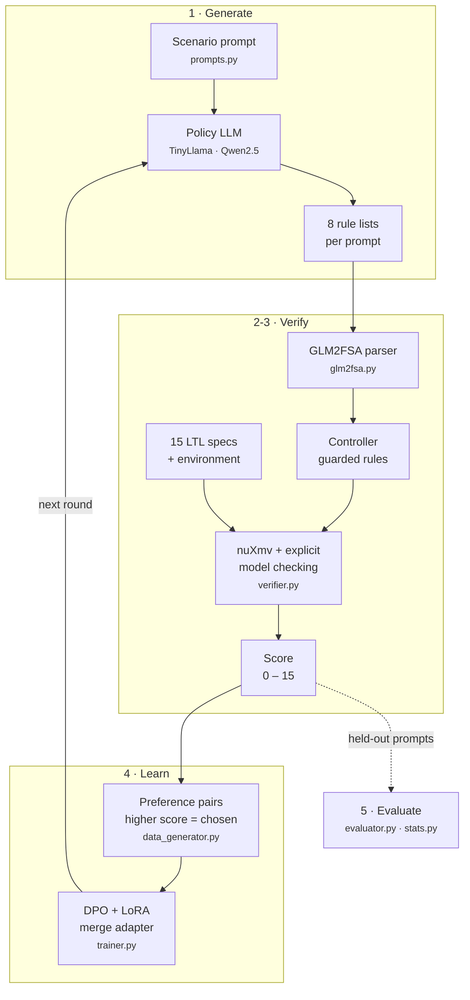

<div align="center">

# LogicTune

**Fine-tuning language models with formal-methods feedback.**<br/>
LLM-written driving controllers → finite-state automata → nuXmv model checking against 15 LTL specifications → DPO.

[](https://github.com/alirafiqmalik/LogicTune/actions/workflows/tests.yml)
[](https://github.com/alirafiqmalik/LogicTune/actions/workflows/pages.yml)


**[▶ Live controller replay](https://alirafiqmalik.github.io/LogicTune/)** · [Results](docs/05-evaluation-and-results.md) · [Pipeline docs](docs/README.md) · [Paper (Yang et al., 2023)](https://arxiv.org/abs/2310.18239)

</div>

This repository reproduces the method of Yang et al.: an LLM writes a rule-based controller for a driving scenario, the text is parsed into an automaton, a model checker counts how many of 15 LTL specifications it satisfies, and those counts rank answers for iterative DPO. The earlier version of this repository scored answers by keyword matching. This version uses real nuXmv model checking with an exact cross-check, held-out evaluation with confidence intervals, an HPC pipeline, and a replay site that uses the recorded results. After three rounds, the satisfaction rate of Qwen/Qwen2.5-3B-Instruct moves from 28.7% to 96.4% (+67.7 pts, 95% CI +64.5 to +71.2, p < 0.001) and its full-pass rate moves from 0.0% to 70.3%, and the satisfaction rate of TinyLlama/TinyLlama-1.1B-Chat-v1.0 moves from 8.1% to 79.2% (+71.1 pts, 95% CI +68.9 to +73.0, p < 0.001) and its full-pass rate moves from 0.0% to 0.3%. Held-out scenarios move from 23.2% to 92.4% for Qwen2.5-3B and from 6.2% to 80.0% for TinyLlama.

## Results at a glance

| Base model | Before DPO | After DPO | Change (95% CI) | p | Held-out scenarios | All 15 specs (full pass) | Pairs (round 1) |
|---|---|---|---|---|---|---|---|
| `Qwen/Qwen2.5-3B-Instruct` | 28.7% | **96.4%** (round 3) | **+67.7 pts** (+64.5 to +71.2) | < 0.001 | 23.2% → 92.4% | 0.0% → 70.3% | 844 |
| `TinyLlama/TinyLlama-1.1B-Chat-v1.0` | 8.1% | **79.2%** (round 3) | **+71.1 pts** (+68.9 to +73.0) | < 0.001 | 6.2% → 80.0% | 0.0% → 0.3% | 816 |

Satisfaction rate = mean share of the 15 LTL specifications satisfied per response, on 340 recorded responses per model (17 scenarios × 2 unseen prompt templates × 10 seeded samples). CI: 95% prompt-level bootstrap of the paired difference; p: sign-flip permutation test over prompts. Source: [`results/latest/`](results/latest/).


<sub>Qwen/Qwen2.5-3B-Instruct · rendered by <code>scripts/plot_results.py</code> from <code>results/latest/qwen2.5-3b/</code></sub>


<sub>TinyLlama/TinyLlama-1.1B-Chat-v1.0 · rendered by <code>scripts/plot_results.py</code> from <code>results/latest/tinyllama-1.1b/</code></sub>

- Qwen/Qwen2.5-3B-Instruct gains +67.7 pts (95% CI +64.5 to +71.2, p < 0.001) and TinyLlama/TinyLlama-1.1B-Chat-v1.0 gains +71.1 pts (95% CI +68.9 to +73.0, p < 0.001). Both gains hold on held-out scenarios, which never appear in training: 23.2% to 92.4%, and 6.2% to 80.0%.
- The full-pass rate is the share of responses that satisfy all 15 specifications. It moves from 0.0% to 70.3% for Qwen2.5-3B and from 0.0% to 0.3% for TinyLlama. The final TinyLlama controllers are mostly "go straight on green, stop otherwise", so they miss pedestrians and stop signs.
- The rate before training is 28.7% and 8.1%, lower than the paper's about 60%, because this verifier is stricter: an undefined action counts as any action.
- Per-specification and per-scenario results are in [Evaluation and results](docs/05-evaluation-and-results.md).

## How it works



1. [Prompts and sampling](docs/01-prompts-and-sampling.md) set the system prompt, the training prompts, and the seeds, and hold four scenarios out of training.
2. [GLM2FSA parsing](docs/02-glm2fsa-parser.md) turns each response into a controller: an ordered list of guarded rules.
3. [Formal verification](docs/03-formal-verification.md) uses nuXmv and an explicit checker to count how many of the 15 LTL specifications each controller satisfies.
4. [DPO training](docs/04-dpo-training.md) ranks answers by that count, builds preference pairs, and updates the policy with DPO and LoRA.
5. [Evaluation](docs/05-evaluation-and-results.md) scores each round on held-out prompts and reports the satisfaction rate with confidence intervals.

## One prompt, before and after

Scenario 1: *Green light but a pedestrian is in front while the car wants to go straight.*  
Prompt `e01_0`, sample 7 · model `Qwen/Qwen2.5-3B-Instruct` · [**replay this pair in the browser →**](https://alirafiqmalik.github.io/LogicTune/#r=qwen2.5-3b&s=1&i=7&a=round0&b=round3)

<table>
<tr>
<td valign="top" width="50%">

**Base model** — **0/15** · fails φ1, φ2, φ3, φ4, φ5, φ6, φ7, φ8, φ9, φ10, φ11, φ12, φ13, φ14, φ15

```text
1. If pedestrian_at_front, stop.
2. If green_traffic_light and not pedestrian_at_front, go_straight.
```

Parsed controller

```text
 1. if u0 -> stop
 2. if green_traffic_light and not u0 -> go_straight
```

</td>
<td valign="top" width="50%">

**After DPO (round 3)** — **15/15** · satisfies every specification

```text
1. If not green_traffic_light, stop.
2. If opposite_car or car_from_left or car_from_right or pedestrian_at_left or pedestrian_at_right or pedestrian_in_front or stop_sign, stop.
3. If green_traffic_light and not (opposite_car or car_from_left or car_from_right or pedestrian_at_left or pedestrian_at_right or pedestrian_in_front or stop_sign), go_straight.
4. If green_left_turn_light, turn_left.
5. If not green_left_turn_light, if opposite_car or car_from_left or car_from_right or pedestrian_at_left or pedestrian_at_right or pedestrian_in_front or stop_sign, stop.
6. If not green_left_turn_light, go_straight.
```

Parsed controller

```text
 1. if not green_traffic_light -> stop
 2. if opposite_car or car_from_left or car_from_right or pedestrian_at_left or pedestrian_at_right or pedestrian_in_front or stop_sign -> stop
 3. if green_traffic_light and not (opposite_car or car_from_left or car_from_right or pedestrian_at_left or pedestrian_at_right or pedestrian_in_front or stop_sign) -> go_straight
 4. if green_left_turn_light -> turn_left
 5. if not green_left_turn_light and (opposite_car or car_from_left or car_from_right or pedestrian_at_left or pedestrian_at_right or pedestrian_in_front or stop_sign) -> stop
 6. if not green_left_turn_light -> go_straight
```

</td>
</tr>
</table>

<p align="center"><a href="https://alirafiqmalik.github.io/LogicTune/#r=qwen2.5-3b&s=1&i=7&a=round0&b=round3"></a><br/><sub>The same pair in the controller replay site (screenshot). The page replays the recorded controllers; the 15 chips are the nuXmv verdicts.</sub></p>

The example uses the same prompt and the same seed for the base model and the final model. The parsed rules and the 15 verdicts come from the recorded run, and the same pair can be replayed on the live page with the link above the example.

## Quickstart

```bash
git clone https://github.com/alirafiqmalik/LogicTune.git && cd LogicTune
pip install -r requirements-cpu.txt          # numpy, networkx, matplotlib, pytest - no GPU

python main.py demo                          # parse + model check four example controllers
python main.py verify --text "If pedestrian_in_front, stop. Otherwise, go_straight." --engine both
python -m pytest -q tests                    # parser, verifier, explicit-vs-nuXmv cross-check
python scripts/check_results.py              # re-verify every committed result
python -m http.server 8000                   # then open http://localhost:8000/simulator/
```

Full pipeline on one GPU (the published runs took 29 minutes for TinyLlama and 47 minutes for Qwen2.5-3B on one NVIDIA L40S):

```bash
pip install --index-url https://download.pytorch.org/whl/cu124 torch==2.5.1
pip install -r requirements.txt
python main.py pipeline --run-dir runs/tinyllama --rounds 3            # base eval -> 3 DPO rounds
python main.py pipeline --run-dir runs/qwen3b --base-model Qwen/Qwen2.5-3B-Instruct --batch-size 4 --grad-accum 4
python main.py export --run-dir runs/qwen3b --run-id qwen2.5-3b         # -> results/latest/qwen2.5-3b/
python scripts/plot_results.py
```

The published runs used the UMass Unity cluster; [slurm/README.md](slurm/README.md) explains how to run the pipeline on a Slurm cluster.

## Documentation map

| Layer | Document | What it covers |
|---|---|---|
| **Overview** | this README | Results, method, quickstart |
| **Pipeline** | [`docs/`](docs/README.md) | One page per stage: [01 prompts](docs/01-prompts-and-sampling.md) · [02 parser](docs/02-glm2fsa-parser.md) · [03 verification](docs/03-formal-verification.md) · [04 DPO](docs/04-dpo-training.md) · [05 results](docs/05-evaluation-and-results.md) |
| **Code** | [`src/logictune/`](src/logictune/README.md) | Module map, import graph, Python API |
| **Operations** | [`slurm/`](slurm/README.md) | Running the pipeline on a Slurm cluster (Unity HPC) |
| **Data** | [`results/`](results/README.md) | Exported runs, file schemas, re-verification |
| **Demo** | [`simulator/`](simulator/README.md) | Controller replay site and its GitHub Pages deployment |

## Repository layout

```text
LogicTune/
├── main.py                    # CLI: demo · verify · pipeline · evaluate · export
├── reproduce_paper.py         # 3-round experiment with default settings
├── src/
│   ├── logictune/             # the package (see src/logictune/README.md)
│   │   ├── prompts.py         #   stage 1 · system prompt, scenarios, split
│   │   ├── generation.py      #   stage 1 · seeded batched sampling
│   │   ├── glm2fsa.py         #   stage 2 · text → controller
│   │   ├── environment.py     #   stage 3 · propositions, actions, fairness
│   │   ├── specs.py           #   stage 3 · the 15 LTL specifications
│   │   ├── verifier.py        #   stage 3 · nuXmv + explicit checker
│   │   ├── data_generator.py  #   stage 4 · scoring and preference pairs
│   │   ├── trainer.py         #   stage 4 · DPO + LoRA (TRL 0.12.2)
│   │   ├── pipeline.py        #   stage 4 · resumable iterative rounds
│   │   ├── evaluator.py       #   stage 5 · held-out evaluation
│   │   ├── stats.py           #   stage 5 · bootstrap and permutation test
│   │   └── export.py          #   results/latest writer
│   └── modelchecker/          # vendored nuXmv 2.1 binary + reference SMV specs
├── tests/                     # parser and verifier tests (incl. nuXmv cross-check)
├── scripts/                   # check_results.py · plot_results.py
├── slurm/                     # cluster jobs and environment setup
├── simulator/                 # controller replay site (GitHub Pages)
├── results/
│   ├── latest/                # published runs (JSON + CSV + figures)
│   └── archive/               # superseded 2025-12-02 run
├── docs/                      # layered stage documentation
├── notebooks/quickstart.ipynb # CPU-only walkthrough
└── .github/workflows/         # tests.yml · pages.yml
```

## Reproducibility

- Versions are pinned (torch 2.5.1, transformers 4.46.3, TRL 0.12.2, PEFT 0.13.2), and each batch uses a fixed seed.
- Every published number is computed from the recorded responses in [`results/latest`](results/latest/), and [`scripts/check_results.py`](scripts/check_results.py) re-parses and re-verifies all of them in CI and before every Pages deploy.
- The training pipeline scores every response with both nuXmv and the explicit checker and stops on any disagreement.
- Each run directory records the GPU and the source commit, and export copies them into `summary.json`.
- Evaluation prompts use instruction templates that never appear in training, and four scenarios are held out of training completely.

## History

The first version of this repository, the December 2025 Colab run, scored answers with keyword rules over 3 specifications. It measured no improvement (96.7% to 93.3%), and its analysis is kept in [`results/archive/colab_run_2025-12-02/RESULTS_REPORT.md`](results/archive/colab_run_2025-12-02/RESULTS_REPORT.md). The present pipeline replaced that scorer, and [`docs/02-glm2fsa-parser.md`](docs/02-glm2fsa-parser.md) documents the reward-hacking episodes found and fixed during this work.

## References

- Y. Yang, N. P. Bhatt, T. Ingebrand, W. Ward, S. Carr, Z. Wang, U. Topcu. *Fine-Tuning Language Models Using Formal Methods Feedback: A Use Case in Autonomous Systems.* MLSys 2024. [arXiv:2310.18239](https://arxiv.org/abs/2310.18239)
- Y. Yang, J.-R. Gaglione, C. Neary, U. Topcu. *Automaton-Based Representations of Task Knowledge from Generative Language Models* (GLM2FSA). [arXiv:2212.01944](https://arxiv.org/abs/2212.01944)
- R. Rafailov, A. Sharma, E. Mitchell, S. Ermon, C. D. Manning, C. Finn. *Direct Preference Optimization: Your Language Model is Secretly a Reward Model.* NeurIPS 2023. [arXiv:2305.18290](https://arxiv.org/abs/2305.18290)
- E. J. Hu et al. *LoRA: Low-Rank Adaptation of Large Language Models.* ICLR 2022. [arXiv:2106.09685](https://arxiv.org/abs/2106.09685)
- nuXmv model checker, Fondazione Bruno Kessler: <https://nuxmv.fbk.eu> (binary vendored in `src/modelchecker/`; see its license terms)
