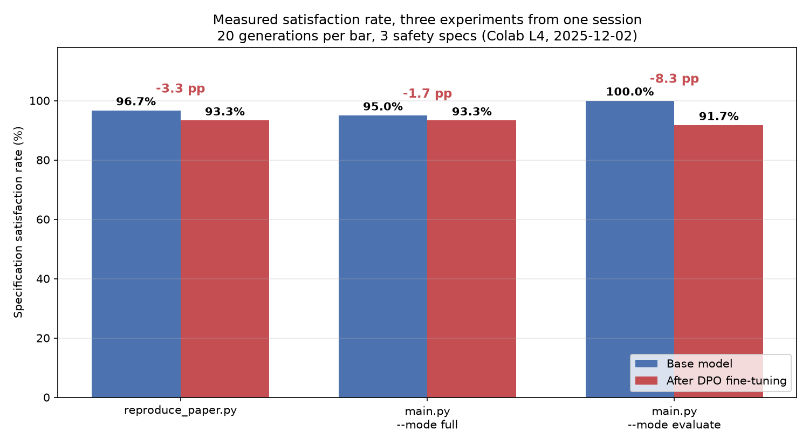
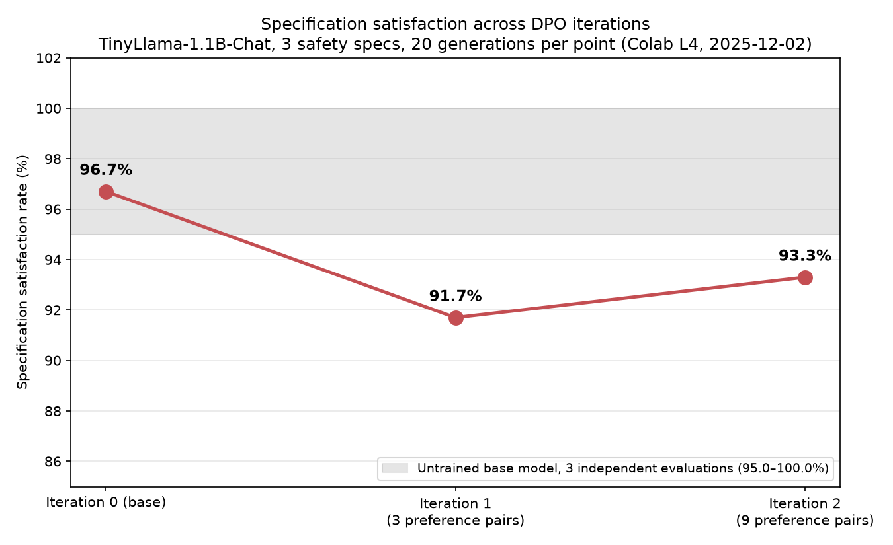
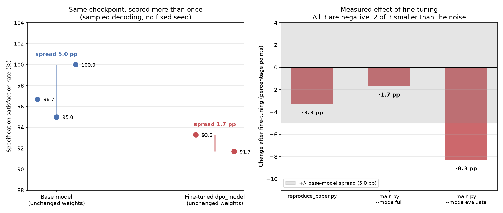
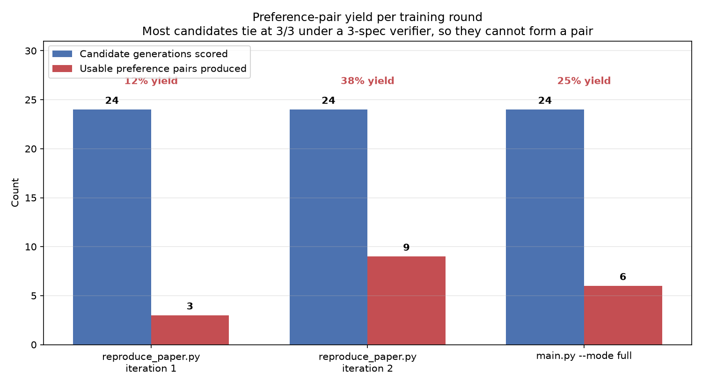
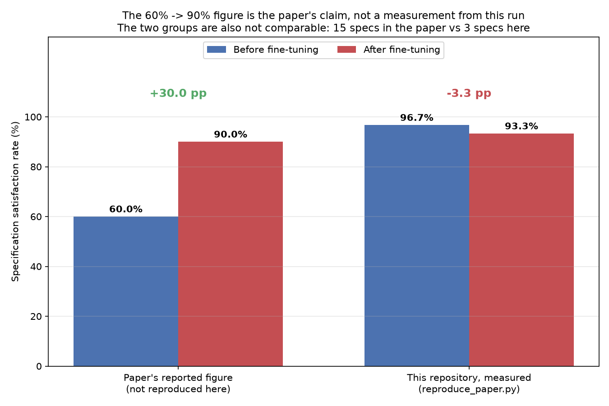

# LogicTune

Fine-tuning language models using formal methods feedback for safe autonomous control policy generation.

This repository implements the pipeline described in **"Fine-Tuning Language Models Using Formal Methods Feedback"**: an LLM proposes control policies, a formal verifier scores them against LTL safety specifications, the scores are turned into preference pairs, and the model is fine-tuned with DPO.

**Status: the pipeline runs end to end, but it has not yet reproduced the paper's improvement.** In the one recorded GPU run, fine-tuning did not improve specification satisfaction. See [Measured Results](#measured-results) below for the numbers and [`RESULTS_REPORT.md`](RESULTS_REPORT.md) for the analysis of why.

**Key Techniques:**
- **DPO (Direct Preference Optimization)**: Preference learning without reward models ([Rafailov et al., 2023](https://arxiv.org/abs/2305.18290))
- **Formal Verification**: Automated feedback using transition systems and safety specifications
- **LoRA**: Parameter-efficient fine-tuning ([Hu et al., 2021](https://arxiv.org/abs/2106.09685))

---

## Measured Results

All numbers below come from a single Colab session on **2025-12-02** on an **NVIDIA L4**, saved in [`Colab_Experiments.ipynb`](Colab_Experiments.ipynb) (also viewable as the [original Colab notebook](https://colab.research.google.com/drive/1GglJdSaECa6XSV3iF1mS0UaVGiYiyZZA?usp=sharing)). The notebook cell outputs are the source of truth; they have been transcribed into [`results/colab_run_2025-12-02/run_results.json`](results/colab_run_2025-12-02/run_results.json) and the figures are rendered from that JSON by [`results/plot_colab_results.py`](results/plot_colab_results.py).

### Headline

| Experiment | Base model | After DPO | Change |
|---|---|---|---|
| `reproduce_paper.py` (2 iterations) | 96.7% | 93.3% | **−3.3 pp** |
| `main.py --mode full` (1 iteration) | 95.0% | 93.3% | **−1.7 pp** |
| `main.py --mode evaluate` (re-score of the same two checkpoints) | 100.0% | 91.7% | **−8.3 pp** |

Fine-tuning made the model slightly *worse* on the verifier in all three experiments. No run showed an improvement.



### Iterative fine-tuning

`reproduce_paper.py` runs two DPO iterations, re-generating training data from the previous checkpoint each time. Satisfaction dropped 5.0 pp after the first iteration and recovered 1.7 pp after the second, ending 3.3 pp below the starting point. The grey band is the spread of three independent evaluations of the *untrained* base model, which is the noise floor for these measurements.



### These effects are not larger than the measurement noise

Evaluation generates with `do_sample=True` at temperature 0.7 and **no seed is set anywhere in the pipeline**, so scoring the same checkpoint twice gives different numbers. The unmodified base model was scored three times during the session and returned 96.7%, 95.0%, and 100.0% — a spread of 5.0 pp, which is wider than two of the three effects attributed to fine-tuning above.



The scores are also coarse. Each evaluation is 20 generations × 3 specifications = 60 points, so a single specification check flipping is worth 1.7 pp and a single generation swinging from 3/3 to 0/3 is worth 5 pp. The three reported effects correspond to a net change of 2, 1, and 5 specification checks. **None of the differences in this run are statistically meaningful.**

### Why so little was learned

DPO can only learn from pairs where one response scores higher than another. Under the 3-specification verifier used in this run, most candidate responses tied at 3/3 and were discarded. Across the whole session, 72 candidate generations produced just **18 usable preference pairs**, and training ran for 3, 6, and 3 optimizer steps respectively. DPO loss stayed at its initialization value of ≈0.69 (`ln 2`) in every round, which is what you see when the policy has barely moved from the reference.



### Relationship to the paper's 60% → 90%

The **60% → 90%** figure is the **paper's reported result**. It is not a measurement from this repository. It appears in this codebase only as a hardcoded target string printed by `reproduce_paper.py` for comparison:

```python
print(f"Paper reports: 60% → 90% (30% improvement)")
```

The measured run and the paper's number are also not directly comparable: the paper's figure is over the full 15-specification suite, whereas the code at the commit that produced these results checked only 3 specifications.



### Evaluation protocol and dataset size

| Quantity | Value |
|---|---|
| Distinct evaluation prompts | 10 |
| Samples per prompt | 2 |
| **Controller generations per model evaluation** | **20** |
| Max score per model evaluation | 60 (20 × 3 specs) |
| Model evaluations performed in the session | 7 |
| **Total evaluation generations** | **140** |
| Distinct training prompts | 6 |
| Training-data generations | 72 (3 rounds × 6 prompts × 4 samples) |
| Usable preference pairs trained on | 18 (3 + 9 + 6) |
| **Total model generations in the session** | **213** |
| Decoding | `do_sample=True`, temperature 0.7, `top_p` 0.9, 200 max new tokens |
| Seeds | none set; every evaluation draws fresh samples |

### Important caveat about the verifier version

The notebook cloned this repository at commit `69c17e3` on 2025-12-02. **At that commit `score_response()` checked 3 safety specifications, not 15**, which is why every evaluation totals out of 60 for 20 responses:

1. Never go straight on red light
2. Never turn left on red light
3. Should not speed through yellow

The 15-specification suite (Φ1–Φ15) documented below was added afterwards in commit `112185a` ("Fixed issue in evaluating rate calculation"). **The Φ1–Φ15 verifier has never been run on a GPU and has no measured results.** Re-running the notebook against current `HEAD` will produce different numbers on a different denominator, and those numbers should not be compared with the ones above.

### Reproducing these figures

The figures are generated from the recorded JSON and require no GPU and no model:

```bash
pip install matplotlib numpy
python results/plot_colab_results.py
```

---

## Installation

```bash
pip install -r requirements.txt
```

## Quick Start

### Reproduce Paper Results
```bash
python reproduce_paper.py
```
Runs the complete two-iteration pipeline and reports the change in specification satisfaction rate. Note that the script prints the paper's 60% → 90% figure as a fixed comparison target; it is not a prediction of what your run will score. The one recorded run of this script scored 96.7% → 93.3%.

### Generate Visualization (No Training Required)
```bash
python visualize_training.py --demo
```
Creates plots of Loss, Accuracy, Marginal Preference, and specification satisfaction analysis. **`--demo` plots synthetic sample data from `generate_sample_data_for_testing()`, not measured results.** For measured results use `python results/plot_colab_results.py`.

### Run Demo (No GPU Required)
```bash
python src/tests/demo.py
```

### Full Pipeline

**1. Verification Demo**
```bash
python main.py --mode demo
```

**2. Generate Training Dataset** (requires GPU)
```bash
python main.py --mode generate --n-responses 4
```

**3. Train Model** (requires GPU)
```bash
python main.py --mode train --epochs 3
```

**4. Test Trained Model**
```bash
python main.py --mode test
```

**5. Evaluate and Compare Models**
```bash
python main.py --mode evaluate
```

**6. Iterative Training** (multiple refinement iterations)
```bash
python main.py --mode iterative --num-iterations 3
```

**7. Visualize Training Results**
```bash
# After training, generate visualization plots
python visualize_training.py --metrics dpo_model/training_metrics.json --eval evaluation_results.json
```


**Run All Steps**
```bash
python main.py --mode full
```

### Using Jupyter Notebook
```bash
jupyter notebook main.ipynb
```

## Library Usage

```python
from logictune import (
    build_traffic_intersection_model,
    parse_response_to_fsa,
    score_response,
    DPODatasetGenerator,
    train_dpo,
    compare_models,
    iterative_training
)

# Build environment model
system = build_traffic_intersection_model()

# Parse and verify a controller
response = "1. If green, go. 2. If yellow, stop. 3. If red, stop."
controller_fsa = parse_response_to_fsa(response)
score, results = score_response(system, controller_fsa, verbose=True)

# Generate training dataset
generator = DPODatasetGenerator()
generator.generate_dataset(output_path="dpo_dataset.jsonl")

# Train with DPO (single iteration)
train_dpo(
    dataset_path="dpo_dataset.jsonl",
    output_dir="trained_model"
)

# Evaluate improvement
comparison = compare_models(
    base_model="TinyLlama/TinyLlama-1.1B-Chat-v1.0",
    fine_tuned_model="trained_model"
)

# Or use iterative training (multiple refinement cycles)
results = iterative_training(
    base_model="TinyLlama/TinyLlama-1.1B-Chat-v1.0",
    initial_output_dir="dpo_model_iter",
    num_iterations=3
)
```

## Project Structure

```
LogicTune/
├── src/
│   ├── logictune/          # Core library
│   │   ├── __init__.py
│   │   ├── environment.py   # Transition system models
│   │   ├── parser.py        # LLM response → FSA (GLM2FSA)
│   │   ├── verifier.py      # Formal verification & scoring (Φ1-Φ15)
│   │   ├── data_generator.py # DPO dataset generation
│   │   ├── trainer.py       # DPO training
│   │   ├── evaluator.py     # Model evaluation & comparison
│   │   ├── training_tracker.py # Metrics logging
│   │   ├── visualizer.py    # Plotting utilities
│   │   ├── iterative_trainer.py # Iterative refinement
│   │   └── prompts.json     # Training prompts
│   ├── modelchecker/        # nuXmv specs
│   └── tests/               # Test and demo scripts
├── results/
│   ├── colab_run_2025-12-02/
│   │   └── run_results.json # Measured results, transcribed from the notebook
│   ├── figures/             # Figures rendered from run_results.json
│   └── plot_colab_results.py # Figure generation (no GPU required)
├── simulator/               # Browser-based AV simulator
├── Colab_Experiments.ipynb  # The GPU run that produced the measured results
├── RESULTS_REPORT.md        # Analysis of the measured results
├── main.py                  # Main execution script
├── main.ipynb               # Jupyter notebook
├── reproduce_paper.py       # End-to-end reproduction script
├── visualize_training.py    # Visualization CLI
└── requirements.txt
```

## How It Works

1. **Environment Model**: Define transition system with safety specifications
2. **Response Generation**: LLM generates diverse control policies (high temperature)
3. **Formal Verification**: Each response scored against the LTL specifications
4. **Preference Pairs**: Create (chosen, rejected) pairs based on scores
5. **DPO Training**: Fine-tune model to prefer high-scoring (safe) responses
6. **Metrics Tracking**: Automatic logging of loss, accuracy, marginal preference, and spec satisfaction
7. **Evaluation**: Compare base vs fine-tuned models on specification satisfaction rate
8. **Visualization**: Generate plots for training analysis and paper figures
9. **Iterative Refinement**: Optional multi-iteration training for continuous improvement

## LTL Specifications (Φ1-Φ15)

The verifier at current `HEAD` checks all 15 specifications from the paper. As noted in [Measured Results](#measured-results), the recorded GPU run predates this suite and used 3 specifications instead, so there are no measured satisfaction rates for the specifications below.

| Spec | Description |
|------|-------------|
| Φ1 | If pedestrian present, eventually stop |
| Φ2 | No left turn when opposite car without green left-turn light |
| Φ3 | No going straight on non-green light |
| Φ4 | If stop sign, eventually stop |
| Φ5 | No right turn when car from left or pedestrian at right |
| Φ6 | Valid action always available |
| Φ7 | If green light, eventually proceed |
| Φ8 | If not green light, eventually stop |
| Φ9 | No turning when car from left |
| Φ10 | If green light, eventually proceed |
| Φ11 | Right turn on non-green only when no car from left |
| Φ12 | Left turn without green arrow only when clear |
| Φ13 | After stopping at sign with no cars, eventually proceed |
| Φ14 | No going straight with pedestrian in front |
| Φ15 | Right turn at stop sign only when no car from left |

## Visualization Features

LogicTune includes visualization tools for analyzing training:

### Plot Types

1. **Training Metrics Line Charts** - Loss, Accuracy, Marginal Preference with shaded error bands
2. **Box and Whisker Plot** - Specification satisfaction distribution vs training epoch
3. **Grouped Bar Chart** - Per-specification satisfaction rates (Base vs Fine-Tuned)

All metrics are automatically tracked during training.

Note that `visualize_training.py --demo` and `generate_sample_data_for_testing()` produce **synthetic** data for checking that the plotting code works. The 200-epoch, 5-seed shapes those functions expect do not correspond to any run that has been performed; the recorded run trained for 3 to 6 optimizer steps on a single seed.

## Known Limitations

These are the concrete blockers to reproducing the paper's result, in rough order of how much they matter:

1. **Preference-pair starvation.** 72 candidate generations yielded 18 pairs. Most candidates tie, so there is nothing for DPO to learn from. More prompts (`prompts.json` now has 85, `prompts_200.json` has 200) and a scorer with finer resolution are the obvious fixes.
2. **Training runs are far too short.** 3–6 optimizer steps at LoRA rank defaults will not move a 1.1B model. DPO loss never left ≈0.69.
3. **Evaluation is too small and unseeded to detect an effect.** 20 generations over 10 prompts gives a 1.7 pp quantization and an observed 5.0 pp spread on identical weights. Detecting a change of the size the paper claims needs a fixed seed, more samples, and repeated evaluations with confidence intervals.
4. **Base model saturates the verifier.** The base model already scores 95–100% on the 3-spec verifier, leaving no headroom. The paper's setup starts at ~60%. The 15-spec verifier at `HEAD` may fix this, but that is untested.
5. **The verifier is text-pattern based, not a model checker.** `score_response()` at `HEAD` parses the response text and applies keyword heuristics via `parse_controller_rules()` and `check_critical_violations()`. `get_traffic_safety_specs()`, `build_product_automaton()`, and `verify_safety_specs()` are retained as no-op API stubs. `src/modelchecker/` ships `traffic_specs.smv` and a `nuXmv` binary, but no Python file invokes either. Satisfaction rates therefore measure phrasing as much as policy safety, and a 3/3 score is not a proof of safety.

## Requirements

- Python 3.8+
- PyTorch 2.0+
- Matplotlib 3.5+ and Seaborn 0.12+ (for visualization)
- GPU recommended for training (CPU works for demo/verification)

The recorded run used Python 3.12, torch 2.9.0+cu126, transformers 4.57.2, trl 0.25.1, peft 0.18.0 and bitsandbytes 0.48.2 on an NVIDIA L4.

## Citation

This work implements techniques from:
- **Main Paper**: "Fine-Tuning Language Models Using Formal Methods Feedback"
- **DPO**: Rafailov et al. "Direct Preference Optimization: Your Language Model is Secretly a Reward Model" (NeurIPS 2023)
- **LoRA**: Hu et al. "LoRA: Low-Rank Adaptation of Large Language Models" (ICLR 2022)
