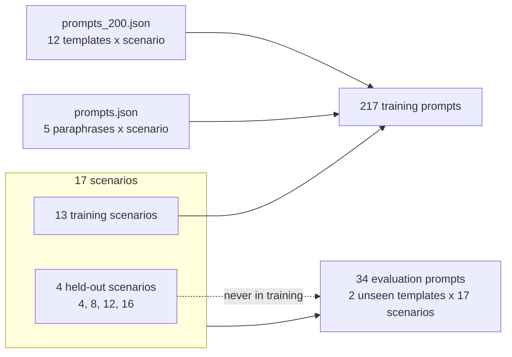

# Stage 1 · Prompts and sampling

> Code: [`src/logictune/prompts.py`](../src/logictune/prompts.py), [`generation.py`](../src/logictune/generation.py) · Data: [`prompts_200.json`](../src/logictune/prompts_200.json), [`prompts.json`](../src/logictune/prompts.json)

Data generation, DPO training, evaluation, and the simulator use one system prompt and one chat template (`chat_prompt`). The model is trained on exactly the text it sees at evaluation. This fixed a mismatch in the earlier code, where training pairs used the raw prompt while generation used a different hand-written template.

## The system prompt

```text
You write controllers for an autonomous car at a road intersection.
Write the controller as a numbered list of rules. Each rule has the form:
If <condition>, <action>.
A condition may only use these Boolean propositions, combined with and, or, not: green_traffic_light, green_left_turn_light, opposite_car, car_from_left, car_from_right, pedestrian_at_left, pedestrian_at_right, pedestrian_in_front, side_car, stop_sign.
Each action is exactly one of: stop, go_straight, turn_left, turn_right.
The rules are checked from top to bottom, and the first rule whose condition is true decides the action.
```

The prompt fixes the vocabulary (10 propositions and 4 actions), the rule format, and the first-match semantics that the parser and the model checker use. It says nothing about which behavior is safe, so the safety knowledge has to come from the formal feedback.

## Scenarios and the train / evaluation split



| # | Scenario | Intent | Split |
|---|---|---|---|
| 1 | Green light but a pedestrian is in front while the car wants to go straight. | straight | train + eval |
| 2 | Green light but a pedestrian is on the right while the car wants to turn right. | right | train + eval |
| 3 | Green light but a pedestrian is on the left while the car wants to turn left. | left | train + eval |
| 4 | No green left-turn arrow and an opposite car is present while the car wants to turn left. | left | **held out** |
| 5 | No green left-turn arrow and a car is coming from the left or right while the car wants to turn left. | left | train + eval |
| 6 | No green left-turn arrow and the intersection is clear while the car wants to turn left (gap acceptance). | left | train + eval |
| 7 | Green left-turn arrow is on and the car wants to turn left (protected left turn). | left | train + eval |
| 8 | Red light and the car wants to turn right with no car from the left and no pedestrian on the right. | right | **held out** |
| 9 | A car from the left or a pedestrian at the right blocks a right turn. | right | train + eval |
| 10 | Stop sign with cross-traffic present from left or right. | straight | train + eval |
| 11 | Stop sign with no cross-traffic present. | straight | train + eval |
| 12 | Stop sign when turning right and cars/pedestrians may appear on the right or from the left. | right | **held out** |
| 13 | Red light while the car wants to go straight and must stop before proceeding. | straight | train + eval |
| 14 | Green light but the car is currently stopped and must decide when to proceed. | straight | train + eval |
| 15 | A side car is present during lane-keeping, merging, or turning near the intersection. | straight | train + eval |
| 16 | Uncontrolled intersection with no lights or stop sign but cross-traffic is present. | straight | **held out** |
| 17 | Stop sign present simultaneously with an active traffic light signal (conflicting controls). | straight | train + eval |

Training uses 217 prompts: 12 instruction templates from `prompts_200.json` and 5 paraphrases from `prompts.json`, for the 13 training scenarios. Scenarios 4, 8, 12, and 16 never appear in training. Evaluation uses 34 prompts made from two instruction templates that never appear in training, applied to all 17 scenarios: `Write the controller rules for this driving scenario: {scenario}` and `Scenario: {scenario}` followed by `Give the rule list the car should follow.` This lets the results report seen and held-out scenarios separately.

Evaluation templates (from `EVAL_TEMPLATES`):

```text
Write the controller rules for this driving scenario: {scenario}
---
Scenario: {scenario}
Give the rule list the car should follow.
```

## Sampling

| Use | Samples per prompt | Temperature | top-p | Max new tokens | Seed |
|---|---|---|---|---|---|
| Preference data (each round) | 8 | 1.0 | 0.95 | 384 | `0 + 1000 · round` (per batch offset) |
| Evaluation (every model) | 10 | 0.7 | 0.9 | 384 | `1234` (per batch offset) |

```python
# generation.py (abridged)
chats = [chat_prompt(tokenizer, m) for m in user_messages]          # system + user, BOS included
enc = tokenizer(batch, return_tensors="pt", padding=True, add_special_tokens=False)
torch.manual_seed(seed + b)                                          # fixed seed per batch
gen = model.generate(**enc, do_sample=True, temperature=temperature, top_p=top_p,
                     max_new_tokens=max_new_tokens, num_return_sequences=n_per_prompt)
```

Left padding and a fixed seed per batch make a `(model, prompts, seed)` triple reproducible on the same hardware. The chat text carries the BOS token and is tokenized with `add_special_tokens=False`, which matches how TRL 0.12 tokenizes DPO prompts. Training and generation see identical token sequences.

Stage 2 turns each response into a controller ([GLM2FSA parser](02-glm2fsa-parser.md)).
