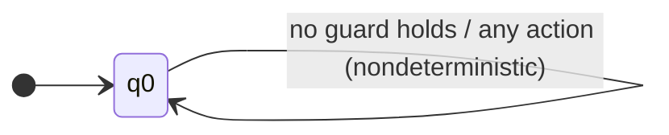
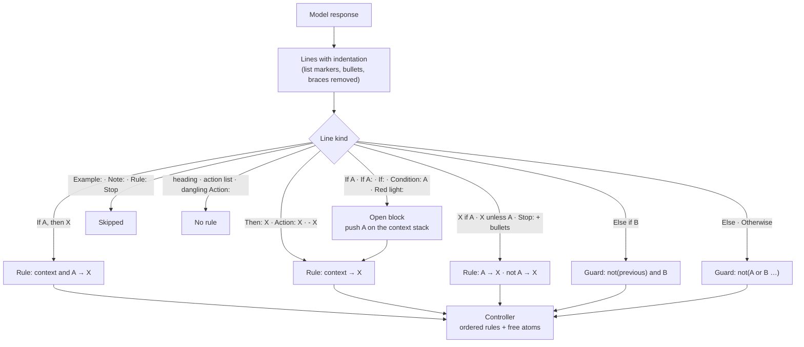

# Stage 2 · GLM2FSA: from text to a controller

> Code: [`src/logictune/glm2fsa.py`](../src/logictune/glm2fsa.py) · Tests: [`tests/test_glm2fsa.py`](../tests/test_glm2fsa.py)

The verifier cannot check prose. Every model response is first turned into a finite-state controller, following the GLM2FSA idea from Yang et al. This stage is deterministic and has no model in it.

## What the parser produces



If no guard holds, the action is undefined, and the model checker treats that as any action. That is the conservative choice: an incomplete controller cannot pass a specification by saying nothing. `phi_6` asks for a complete controller.

- One automaton state, `q0`, with an ordered list of guarded self-loops.
- The first matching guard fires on each time step.
- The last edge, where no guard holds, allows any action.

## How a response is read



1. The response is split into lines, and indentation is kept after list markers and bullets are removed.
2. A condition header (`If A`, `If A:`, or `If:`) opens a block and pushes that condition on the context stack.
3. An `else if` or `else` chain negates the earlier conditions of the same chain.
4. A `then` line or a bullet line attaches an action to the open block.
5. Inline rules are `If A, X`, `X if A`, and `X unless A`.
6. `Example` and `Note` blocks are skipped.

Code-style braces are stripped before a line is classified, so a brace block is read as the same if/else chain.

- A block keeps the lines at its header's own indentation until a blank line, unless the header already has a deeper-indented body or both lines are numbered list items. A header stays open across a blank line until it receives its first rule.
- An inline rule that ends with a colon, such as "If A, stop:", also opens a block for the lines after it.
- Two or more different bare actions in a row at top level, such as "1. Stop / 2. Go straight / 3. Turn left", are a list of the action vocabulary and produce no rule.
- A top-level unconditional action that is followed by more rules is treated as a heading, for example "1. Stop" above a group of rules, and is dropped. Under first-match that action would make every later rule unreachable. Only a final unconditional action is kept, as a default.
- A condition with no content, such as "If there is, stop.", becomes a free atom, not "always true". An "Action:" or "then" line with no open condition is not a rule.

The reading is conservative on purpose, because a stop action that is wrongly made unconditional makes an answer look safer than it is, and the training runs showed that the policy learns to produce such layouts.

## Conditions and actions

A condition phrase becomes a Boolean expression over the 10 propositions. Exact identifiers such as `green_traffic_light` match directly, and common phrases map to a proposition or to a small macro: "the light is red" is `not green_traffic_light`, "an oncoming car" is `opposite_car`, and "no pedestrians or cars" uses the macros for any pedestrian, any car, and clear. `and`, `or`, `not`, and "no X or Y" go through a small recursive-descent parser. A phrase with no known proposition, for example "the road is wet", becomes a fresh free atom `u0`, `u1`, and so on, which the model checker treats as unconstrained, so the controller is not given credit for a condition it cannot be checked against. The four canonical actions are `stop`, `go_straight`, `turn_left`, and `turn_right`; "do not turn left" maps to `stop`, while "prepare to stop" and "slow down" are not actions.

### Examples (output of the current parser)

| Response text | Parsed rule(s) |
|---|---|
| `If pedestrian_in_front, stop.` | `pedestrian_in_front` → `stop` |
| `Stop if the light is red.` | `not green_traffic_light` → `stop` |
| `Go straight unless a pedestrian is in front.` | `not pedestrian_in_front` → `go_straight` |
| `If there are no pedestrians or cars, turn right.` | `not (pedestrian_in_front or pedestrian_at_left or pedestrian_at_right or opposite_car or car_from_left or car_from_right)` → `turn_right` |
| `If the road is wet, stop.` | `u0` → `stop`<br>`u0` = free atom for “road wet” |
| <code>If (green_traffic_light AND opposite_car)<br>Then:<br>- Stop<br><br>Else:<br>- Go straight</code> | `green_traffic_light and opposite_car` → `stop`<br>`not (green_traffic_light and opposite_car)` → `go_straight` |
| <code>if (pedestrian_in_front) {<br>&nbsp;&nbsp;stop();<br>} else if (green_traffic_light) {<br>&nbsp;&nbsp;go_straight();<br>}</code> | `pedestrian_in_front` → `stop`<br>`not pedestrian_in_front and green_traffic_light` → `go_straight` |

These rows are produced by running `extract_rules` on the left column, and the same cases are asserted in `tests/test_glm2fsa.py`.

## Why the parser matters for training: a reward-hacking episode

In the first full run, the satisfaction rate on held-out prompts went from 17.9% to 60.9% after one DPO round. The outputs used block layouts such as `If <condition>` / `Then:` / `- Stop` / `Else:` / `- Go straight` and `Else if X is true,` lines. The old extractor did not know these layouts and read the bullet actions as unconditional rules, so most such answers scored as always stop (12/15). Re-scored with the final parser, the same round-1 answers score 31.1% instead of 60.9% (213 of 340 answers change). The two runs were cancelled, and all experiments were re-run with the fixed parser.

| Recorded answer (round-1 model) | Old parser | Fixed parser |
|---|---|---|
| <code>If (green_traffic_light AND opposite_car)<br>Then:<br>- Stop<br><br>Else:<br>- Go straight</code> | `true → stop` (always stop: 12/15) | `green_traffic_light and opposite_car → stop`<br>`not (…) → go_straight` |
| <code>If green_left_turn_light is true,<br>&nbsp;&nbsp;stop<br>Else if opposite_car is true,<br>&nbsp;&nbsp;go_straight</code> | `green_left_turn_light → stop`<br>`true → go_straight` | `green_left_turn_light → stop`<br>`not green_left_turn_light and opposite_car → go_straight` |
| <code>If not green_traffic_light or not green_left_turn_light, if opposite_car, if car_from_left, stop.</code> (Qwen2.5-3B, round 1) | `not green_traffic_light or not green_left_turn_light or opposite_car or car_from_left → stop` | `(not green_traffic_light or not green_left_turn_light) and opposite_car and car_from_left → stop` |
| <code>If<br><br>- green_left_turn_light<br>- opposite_car<br><br>Then<br><br>- stop</code> (TinyLlama, round 2) | `true → stop` (always stop: 12/15) | `green_left_turn_light and opposite_car → stop` |
| <code>1. Stop<br>2. Go straight ahead<br>3. Turn left<br>4. Turn right</code> (TinyLlama, round 2) | `true → stop` (shadows every later rule) | no rule: a list of the action vocabulary is not a controller |

In the first Qwen2.5-3B run, the round-1 model wrote chained conditions ("If A, if B, if C, stop"), and the old comma rule read them as a disjunction, as in the third row of the table. With the fix, 165 of 340 recorded answers changed, and their satisfaction rate went from 69.8% to 65.7%. In the next TinyLlama run, round 2 reached 68.6% with 253 of 340 answers at exactly 12/15; a bare "If" with bullet conditions, bodies at the same indentation as their header, and lists of the action vocabulary were read as unconditional stop rules, as in the last two rows, and the final parser scores the same answers at 40.1%. The fix is conservative: when it is unclear whether an action belongs to a condition, the action stays inside the condition, and a list of different bare actions is not a rule. Two further rounds of fixes, five in total, came from the round-1 answers of the next two runs ("Condition: A / Action: X" pairs, short labels such as "Red light:", "Stop if" followed by condition bullets, "A, B, or C" lists, "If there is, stop.", dangling "Action:" lines, "Rule: Stop" titles, and action names used as section headings), and every reported run was restarted from scratch with the parser at commit `17f2a0e` for both the reward and the evaluation.

The verifier is the reward, so every parser gap is an exploit. The fix was to parse if/else structure faithfully and then retrain from scratch, and the reported results come only from runs that used the fixed parser.

## API

```python
from logictune import extract_rules

ctrl = extract_rules("""1. If pedestrian_in_front, stop.
2. If not green_traffic_light, stop.
3. Otherwise, go_straight.""")
print(ctrl.pretty())
#  1. if pedestrian_in_front -> stop
#  2. if not green_traffic_light -> stop
#  3. if green_traffic_light -> go_straight
ctrl.to_json()      # rules with guard ASTs (used by the simulator)
ctrl.to_networkx()  # one-state FSA for plotting
```

Stage 3 model-checks that controller against the 15 specifications ([formal verification](03-formal-verification.md)).
