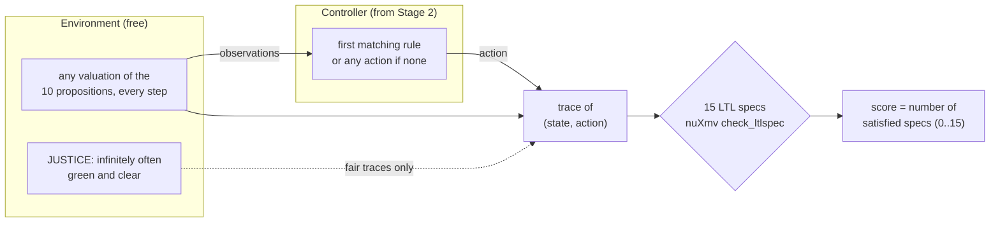

# Stage 3 · Formal verification: model checking the controller

> Code: [`src/logictune/verifier.py`](../src/logictune/verifier.py), [`specs.py`](../src/logictune/specs.py), [`environment.py`](../src/logictune/environment.py) · Binary: [`src/modelchecker/nuXmv`](../src/modelchecker/) · Tests: [`tests/test_verifier.py`](../tests/test_verifier.py)

The score of a response is the number of the 15 LTL specifications that its controller satisfies when composed with the environment model. This is model checking with nuXmv, and it replaces the earlier keyword heuristics. A second, exact explicit-state checker gives the same verdicts and is used as a cross-check and as a fast path.



## Environment model

| Proposition | Meaning |
|---|---|
| `green_traffic_light` | main signal is green (false = red or yellow) |
| `green_left_turn_light` | protected left-turn arrow is on |
| `opposite_car` | oncoming car in the opposite lane |
| `car_from_left` | cross traffic approaching from the left |
| `car_from_right` | cross traffic approaching from the right |
| `pedestrian_at_left` | pedestrian on the left crosswalk |
| `pedestrian_at_right` | pedestrian on the right crosswalk |
| `pedestrian_in_front` | pedestrian on the crosswalk ahead |
| `side_car` | vehicle alongside the ego car |
| `stop_sign` | stop sign at the approach |

Every proposition is free and may change on every step, which is the most adversarial environment consistent with the propositions. Free atoms from the parser are added as extra free variables. The model also states a fairness assumption, `JUSTICE green_traffic_light & !opposite_car & !car_from_left & !car_from_right & !pedestrian_at_left & !pedestrian_at_right & !pedestrian_in_front & !side_car & !stop_sign;`. Without it, no controller that waits for pedestrians could satisfy the liveness specifications, because the environment could keep a pedestrian in front forever.

## The 15 specifications

| Spec | LTL formula | Kind | Meaning |
|---|---|---|---|
| `phi_1` | `□(pedestrian_in_front → ◇ stop)` | liveness | If a pedestrian is in front, the car eventually stops. |
| `phi_2` | `□(opposite_car ∧ ¬green_left_turn_light → ¬turn_left)` | safety | No unprotected left turn with an oncoming car. |
| `phi_3` | `□(¬green_traffic_light → ¬go_straight)` | safety | Never go straight unless the light is green. |
| `phi_4` | `□(stop_sign → ◇ stop)` | liveness | At a stop sign, the car eventually stops. |
| `phi_5` | `□(car_from_left ∨ pedestrian_at_right → ¬turn_right)` | safety | No right turn with a car from the left or a pedestrian on the right. |
| `phi_6` | `□(stop ∨ go_straight ∨ turn_left ∨ turn_right)` | safety | The controller always prescribes one of the four actions. |
| `phi_7` | `◇(green_traffic_light ∨ green_left_turn_light) → ◇¬stop` | liveness | If a green light eventually shows, the car eventually moves. |
| `phi_8` | `□(¬green_traffic_light → ◇ stop)` | liveness | If the light is not green, the car eventually stops. |
| `phi_9` | `□(car_from_left → ¬(turn_left ∨ turn_right))` | safety | No turns while a car comes from the left. |
| `phi_10` | `□(green_traffic_light → ◇¬stop)` | liveness | After a green light, the car eventually moves. |
| `phi_11` | `□(turn_right ∧ ¬green_traffic_light → ¬car_from_left)` | safety | Right turn on a non-green light only with no car from the left. |
| `phi_12` | `□(turn_left ∧ ¬green_left_turn_light → ¬car_from_right ∧ ¬car_from_left ∧ ¬opposite_car)` | safety | Unprotected left turn only when no car comes from any direction. |
| `phi_13` | `□(stop_sign ∧ ¬car_from_left ∧ ¬car_from_right → ◇¬stop)` | liveness | At a stop sign with no cross traffic, the car eventually moves. |
| `phi_14` | `□(go_straight → ¬pedestrian_in_front)` | safety | Never go straight into a pedestrian. |
| `phi_15` | `□(turn_right ∧ stop_sign → ¬car_from_left)` | safety | Right turn at a stop sign only with no car from the left. |

The formulas follow Yang et al. (2023). A literal encoding of `phi_6` is a tautology, because the action variable only has these four values, so `phi_6` is encoded as "the controller always prescribes an action" (`G action_defined`). "Always stop" satisfies 12 of 15 (it fails exactly `phi_7`, `phi_10`, and `phi_13`) and "always go straight" satisfies 10, which is why the full-pass rate (15/15) is reported next to the mean.

## The generated model

This is the exact SMV text that `controller_to_smv` writes for the demo controller in [`main.py`](../main.py) (`python main.py verify --smv --text "..."`):

```text
1. If there is a pedestrian in front of the car, stop.
2. If the light is red or yellow, come to a complete stop.
3. If the light is green and the intersection is clear, proceed straight.
4. Otherwise, stop.
```

```smv
MODULE main
VAR
  green_traffic_light : boolean;
  green_left_turn_light : boolean;
  opposite_car : boolean;
  car_from_left : boolean;
  car_from_right : boolean;
  pedestrian_at_left : boolean;
  pedestrian_at_right : boolean;
  pedestrian_in_front : boolean;
  side_car : boolean;
  stop_sign : boolean;
  nd_action : {stop, go_straight, turn_left, turn_right};
DEFINE
  action :=
    case
      pedestrian_in_front : stop;
      !green_traffic_light : stop;
      green_traffic_light & !(opposite_car | car_from_left | car_from_right | pedestrian_in_front | pedestrian_at_left | pedestrian_at_right) : go_straight;
      !(green_traffic_light & !(opposite_car | car_from_left | car_from_right | pedestrian_in_front | pedestrian_at_left | pedestrian_at_right)) : stop;
      TRUE : nd_action;
    esac;
  action_defined := (pedestrian_in_front) | (!green_traffic_light) | (green_traffic_light & !(opposite_car | car_from_left | car_from_right | pedestrian_in_front | pedestrian_at_left | pedestrian_at_right)) | (!(green_traffic_light & !(opposite_car | car_from_left | car_from_right | pedestrian_in_front | pedestrian_at_left | pedestrian_at_right)));
JUSTICE green_traffic_light & !opposite_car & !car_from_left & !car_from_right & !pedestrian_at_left & !pedestrian_at_right & !pedestrian_in_front & !side_car & !stop_sign;
LTLSPEC NAME phi_1 := G (pedestrian_in_front -> F (action = stop));
LTLSPEC NAME phi_2 := G ((opposite_car & !green_left_turn_light) -> !(action = turn_left));
LTLSPEC NAME phi_3 := G (!green_traffic_light -> !(action = go_straight));
LTLSPEC NAME phi_4 := G (stop_sign -> F (action = stop));
LTLSPEC NAME phi_5 := G ((car_from_left | pedestrian_at_right) -> !(action = turn_right));
LTLSPEC NAME phi_6 := G action_defined;
LTLSPEC NAME phi_7 := (F (green_traffic_light | green_left_turn_light)) -> F !(action = stop);
LTLSPEC NAME phi_8 := G (!green_traffic_light -> F (action = stop));
LTLSPEC NAME phi_9 := G (car_from_left -> !((action = turn_left) | (action = turn_right)));
LTLSPEC NAME phi_10 := G (green_traffic_light -> F !(action = stop));
LTLSPEC NAME phi_11 := G (((action = turn_right) & !green_traffic_light) -> !car_from_left);
LTLSPEC NAME phi_12 := G (((action = turn_left) & !green_left_turn_light) -> (!car_from_right & !car_from_left & !opposite_car));
LTLSPEC NAME phi_13 := G ((stop_sign & !car_from_left & !car_from_right) -> F !(action = stop));
LTLSPEC NAME phi_14 := G ((action = go_straight) -> !pedestrian_in_front);
LTLSPEC NAME phi_15 := G (((action = turn_right) & stop_sign) -> !car_from_left);
```

The action is a `DEFINE` with a `case` expression that encodes rule priority, and the final `TRUE` branch uses the free variable `nd_action`, which is how "no rule applies" becomes "any action". nuXmv is run with `-dcx` and a command script (`go`, `check_ltlspec`, `show_property -l`), and the verdicts are read by property name. This controller scores 14/15: it fails `phi_4` because it has no stop-sign rule and can drive through a stop sign on a clear green light.

## Two engines, one answer

| Specification form | Fails exactly when (A(w) = actions the controller allows in valuation w, J = fair valuations) |
|---|---|
| `G p`, p over the state and the action | some valuation w and some a ∈ A(w) violate p |
| `G (c -> F stop)` | some w ⊨ c allows a non-stop action, and some j ∈ J allows a non-stop action |
| `G (c -> F !stop)` | some w ⊨ c allows stop, and some j ∈ J allows stop |
| `F (green | green_left) -> F !stop` | some j ∈ J allows stop |

These reductions are exact because the controller has no memory and any valuation can follow any valuation. A counterexample path can be built from one bad valuation followed by one fair valuation repeated forever, and the converse holds as well. The explicit checker enumerates all `2^(10+k)` valuations with numpy, where `k` is the number of free atoms and is at most 10.

- 1,000 random controllers (random guards, rules, and free atoms) gave identical verdicts in both engines, and every specification was seen both true and false.
- The unit test `test_explicit_checker_matches_nuxmv` repeats this on 60 random controllers in CI.
- The training pipeline runs with `engine="both"`, which raises an error on any disagreement, so every score in the published runs was confirmed by nuXmv.

```python
from logictune import verify_response, format_result

res = verify_response(open("response.txt").read(), engine="both")  # explicit | nuxmv | both
print(res.score, res.specs["phi_14"])
print(format_result(res))
```

Stage 4 turns those scores into preference pairs and trains the policy ([DPO training](04-dpo-training.md)).
