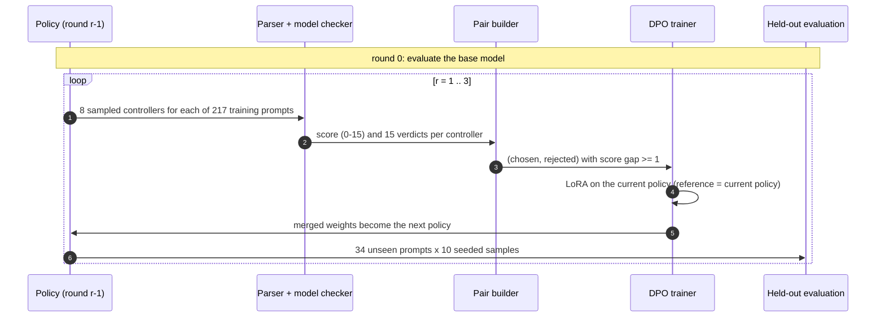
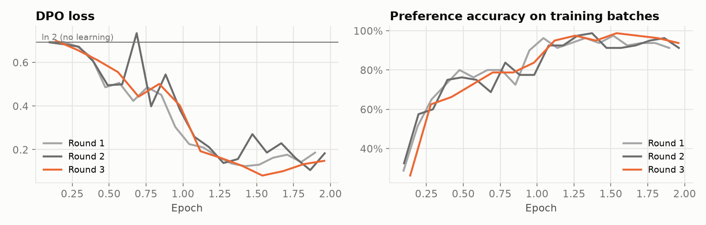
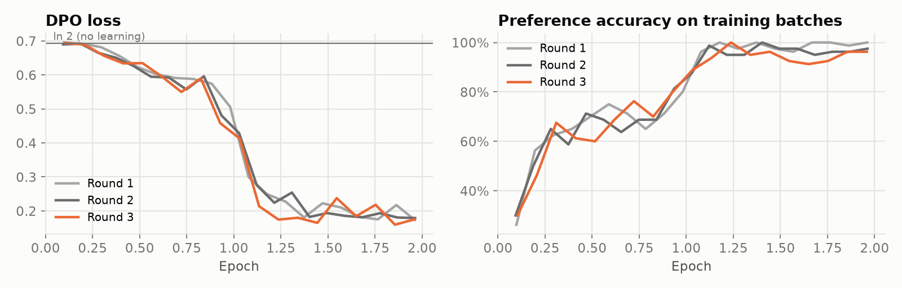

# Stage 4 · DPO with formal-methods feedback

> Code: [`src/logictune/data_generator.py`](../src/logictune/data_generator.py), [`trainer.py`](../src/logictune/trainer.py), [`pipeline.py`](../src/logictune/pipeline.py), [`config.py`](../src/logictune/config.py)

The verifier score replaces human preference labels. For each training prompt the current policy writes several controllers, the model checker scores them, and Direct Preference Optimization (Rafailov et al., 2023) pushes the policy toward the higher-scored answers. Training is iterative and on-policy, as in Yang et al. (2023).



## From scores to preference pairs

```python
# data_generator.build_preference_pairs (abridged)
for a in unique_responses:                 # same prompt
    for b in unique_responses:
        gap = a["score"] - b["score"]
        if gap >= min_gap:                 # min_gap = 1
            candidates.append((gap, a, b))
# largest gaps first; each rejected answer used once, each chosen answer at most twice,
# at most max_pairs_per_prompt = 4 pairs per prompt
```

Pair yield matters because DPO needs two answers to the same prompt with different scores. The old 3-specification scorer gave almost every answer 3/3, so the 2025-12-02 run produced only 18 pairs in total and the DPO loss never left `ln 2`. With 15 specifications and complete-controller semantics the scores spread out, and the first round of each run produced more than 800 pairs from almost every one of the 217 prompts. The exact counts are in the results table of [Stage 5](05-evaluation-and-results.md) and in `results/latest/<run>/rounds.csv`.

## Training one round

| Setting | Value | Why |
|---|---|---|
| Adapter | LoRA r = 16, α = 32, dropout 0.05 on `q, k, v, o, gate, up, down` projections | Small, fast, merges into the weights |
| Reference model | the policy that sampled the round's data (adapters disabled) | On-policy DPO |
| β | 0.1 | Standard DPO temperature |
| Learning rate | 5e-05 (cosine, 10% warm-up) | |
| Epochs | 2.0 | |
| Batch | 8 × 2 accumulation (TinyLlama); 4 × 4 (Qwen2.5-3B) | Effective batch 16 |
| Max length | 1024 tokens (prompt ≤ 512) | |
| Precision | bf16 | |
| Variant | `--rpo-alpha 0.5` adds an NLL term on the chosen answer (RPO) | Reported as a separate run where used |

```python
# trainer.train_dpo (abridged) - pinned TRL 0.12.2
trainer = DPOTrainer(model=model, ref_model=None, args=DPOConfig(beta=beta, ...),
                     train_dataset=pairs_with_chat_prompts, processing_class=tokenizer,
                     peft_config=LoraConfig(r=16, lora_alpha=32, target_modules=LORA_TARGETS))
trainer.train()
merged = trainer.model.merge_and_unload()     # the next round starts from this model
merged.save_pretrained(out / "model")
```

The adapter is merged after every round. The next round's data comes from the merged policy, and that policy is also the next round's DPO reference, which keeps each round's KL anchor on the model that produced the data. The old trainer tried six different TRL call signatures; this trainer pins TRL at 0.12.2 and makes one `DPOTrainer` call.

## Resumable rounds

- Each stage writes its outputs (`train_samples.jsonl`, `pairs.jsonl`, `model/`, `train_log.json`, `eval_roundN.jsonl`) and is skipped when they exist.
- A run stops early if a round yields fewer than `min_pairs` = 32 pairs.
- `history.json` and `summary.json` collect per-round metrics.

## Measured training signal

| Run | Round | Training samples: satisfaction | Prompts with pairs | Pairs | Mean score gap | DPO steps | Final train loss |
|---|---|---|---|---|---|---|---|
| `Qwen/Qwen2.5-3B-Instruct` | 1 | 27.9% | 216 / 217 | 844 | 7.3 | 104 | 0.341 |
| `Qwen/Qwen2.5-3B-Instruct` | 2 | 68.1% | 216 / 217 | 813 | 3.5 | 102 | 0.376 |
| `Qwen/Qwen2.5-3B-Instruct` | 3 | 84.4% | 181 / 217 | 571 | 2.8 | 70 | 0.344 |
| `TinyLlama/TinyLlama-1.1B-Chat-v1.0` | 1 | 18.0% | 212 / 217 | 816 | 7.0 | 102 | 0.412 |
| `TinyLlama/TinyLlama-1.1B-Chat-v1.0` | 2 | 44.4% | 217 / 217 | 852 | 6.8 | 106 | 0.409 |
| `TinyLlama/TinyLlama-1.1B-Chat-v1.0` | 3 | 67.0% | 214 / 217 | 769 | 3.3 | 96 | 0.400 |

In each round, most prompts yield pairs: Qwen/Qwen2.5-3B-Instruct yields pairs from 216/217, 216/217, and 181/217 prompts (844, 813, and 571 pairs), and TinyLlama/TinyLlama-1.1B-Chat-v1.0 yields pairs from 212/217, 217/217, and 214/217 prompts (816, 852, and 769 pairs). The training curves leave ln 2 within each round, and the final training loss is 0.341, 0.376, and 0.344 for Qwen2.5-3B and 0.412, 0.409, and 0.400 for TinyLlama; the 2025-12-02 run stayed within 0.008 of ln 2. Training-sample satisfaction rises from 27.9% to 68.1% to 84.4% for Qwen2.5-3B and from 18.0% to 44.4% to 67.0% for TinyLlama, because each round samples from the improved policy.


<sub>Qwen/Qwen2.5-3B-Instruct · <code>results/latest/qwen2.5-3b/training_curves.csv</code></sub>


<sub>TinyLlama/TinyLlama-1.1B-Chat-v1.0 · <code>results/latest/tinyllama-1.1b/training_curves.csv</code></sub>

Stage 5 states the evaluation protocol and the measured results ([evaluation and results](05-evaluation-and-results.md)).
