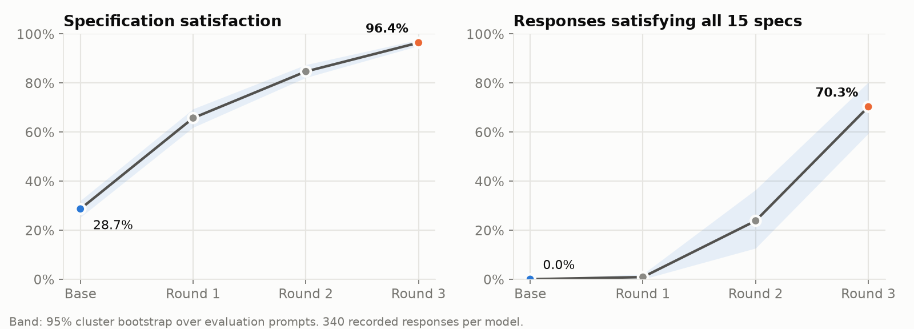
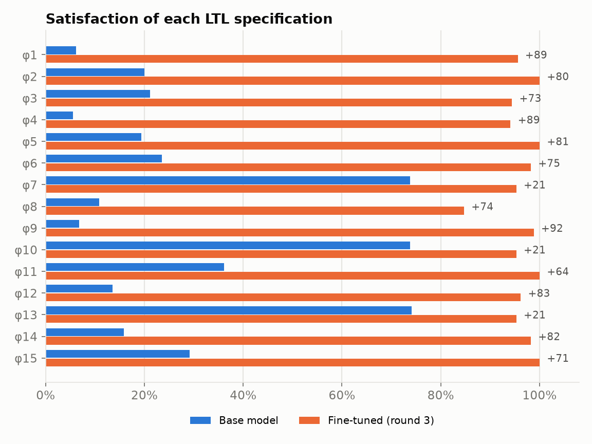
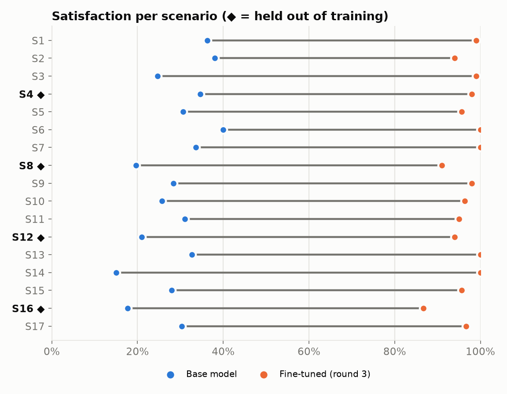
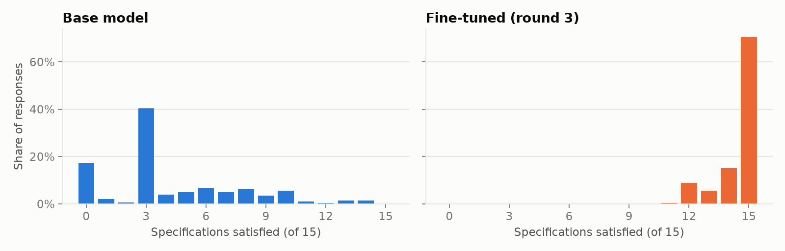
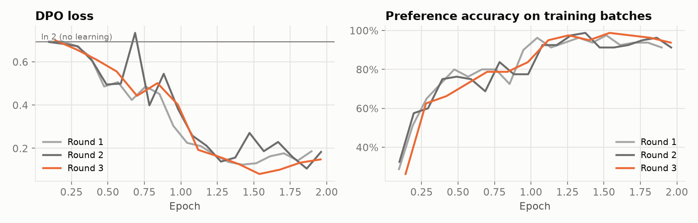
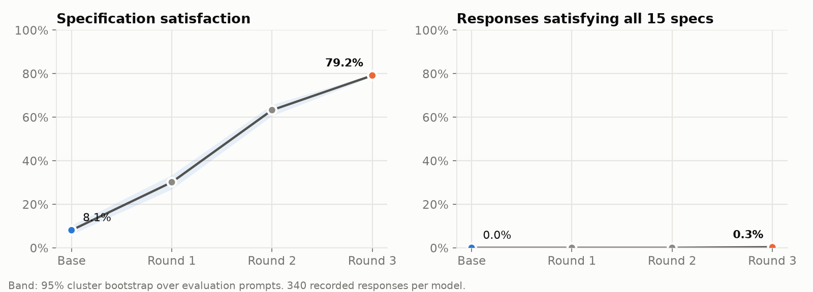
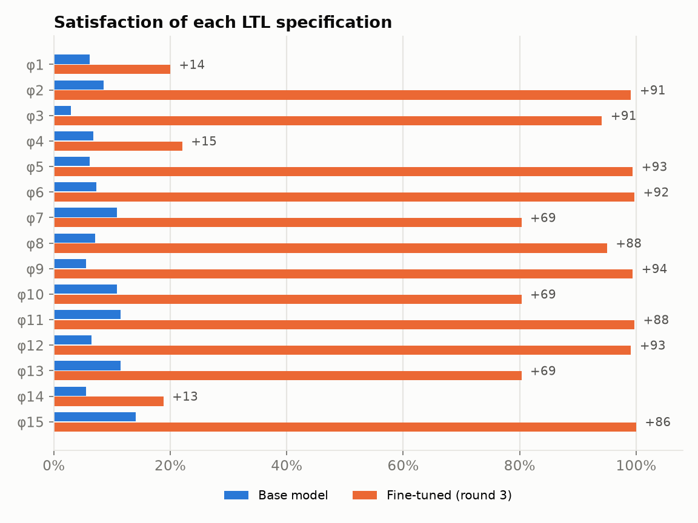
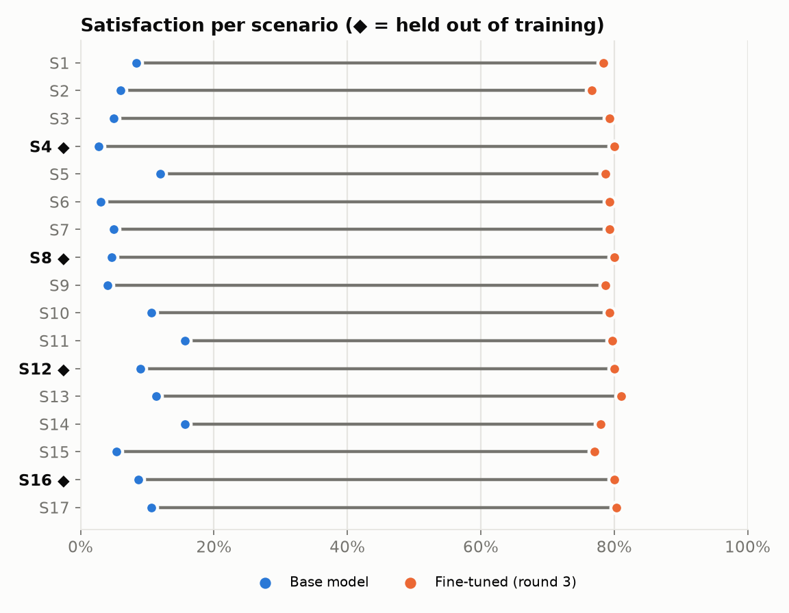
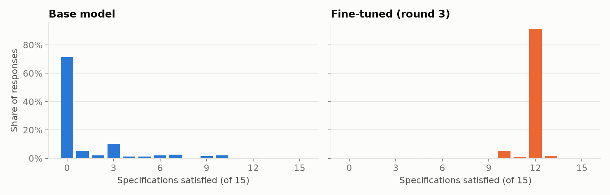
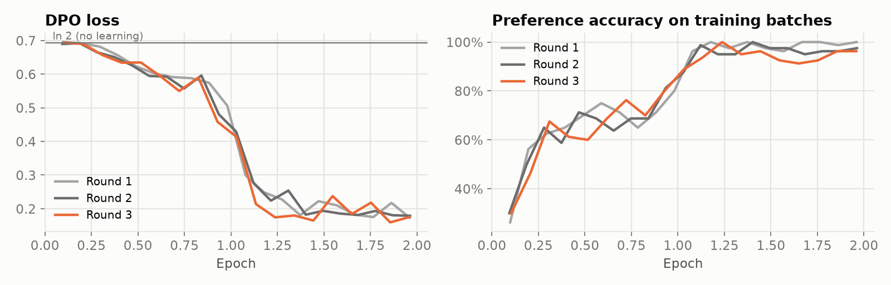

# Stage 5 · Evaluation and results

> Code: [`src/logictune/evaluator.py`](../src/logictune/evaluator.py), [`stats.py`](../src/logictune/stats.py), [`export.py`](../src/logictune/export.py) · Data: [`results/latest/`](../results/latest/) · Check: [`scripts/check_results.py`](../scripts/check_results.py)

This page defines the evaluation protocol and reports the measured results of every published run. Every number below is computed from the recorded responses in [`results/latest`](../results/latest/) and is re-verified by [`scripts/check_results.py`](../scripts/check_results.py).

## Protocol

| Item | Value |
|---|---|
| Evaluation prompts | 34 = 17 scenarios × 2 instruction templates that never appear in training |
| Held-out scenarios | 4, 8, 12, 16 (no training prompt mentions them) |
| Samples per prompt | 10, temperature 0.7, top-p 0.9, max 384 new tokens, seed 1234 |
| Responses per model | 340 |
| Score of a response | number of the 15 LTL specifications satisfied (nuXmv, cross-checked) |
| Satisfaction rate | mean score / 15 over the 340 responses |
| Full-pass rate | share of responses with score 15 |
| Interval | 95% bootstrap over prompts (5,000 resamples; responses to one prompt are resampled together) |
| Change vs base | paired by prompt; 95% bootstrap interval and a sign-flip permutation test (20,000 draws) |

The 10 samples of one prompt are correlated, so the bootstrap resamples prompts and keeps each prompt's responses together. The base model and the fine-tuned model are compared per prompt, on the same prompts and the same seeds. The 2025-12-02 run used 20 unseeded generations per model and could not separate an effect from noise.

## Qwen/Qwen2.5-3B-Instruct

Run `qwen3b-r5` · GPU: NVIDIA L40S · source commit `17f2a0e` · data: [`results/latest/qwen2.5-3b/`](../results/latest/qwen2.5-3b/)

| Round | Satisfaction | 95% CI | Full pass | Parse rate | Seen scenarios | Held-out scenarios | Training pairs | DPO steps | Δ vs base (95% CI) | p |
|---|---|---|---|---|---|---|---|---|---|---|
| Base model | **28.7%** | 25.2% – 32.0% | 0.0% | 100.0% | 30.3% | 23.2% | — | — | — | — |
| Fine-tuned (round 1) | **65.7%** | 61.9% – 69.4% | 0.9% | 100.0% | 66.6% | 62.7% | 844 | 104 | +37.0 pts (+31.6 to +42.5) | < 0.001 |
| Fine-tuned (round 2) | **84.7%** | 82.2% – 87.4% | 23.8% | 100.0% | 85.8% | 81.1% | 813 | 102 | +56.0 pts (+51.9 to +60.3) | < 0.001 |
| Fine-tuned (round 3, final) | **96.4%** | 95.1% – 97.6% | 70.3% | 100.0% | 97.6% | 92.4% | 571 | 70 | +67.7 pts (+64.5 to +71.2) | < 0.001 |

| Spec | Formula | Base | Final | Change |
|---|---|---|---|---|
| φ1 | `□(pedestrian_in_front → ◇ stop)` | 6.2% | 95.6% | +89 |
| φ2 | `□(opposite_car ∧ ¬green_left_turn_light → ¬turn_left)` | 20.0% | 100.0% | +80 |
| φ3 | `□(¬green_traffic_light → ¬go_straight)` | 21.2% | 94.4% | +73 |
| φ4 | `□(stop_sign → ◇ stop)` | 5.6% | 94.1% | +89 |
| φ5 | `□(car_from_left ∨ pedestrian_at_right → ¬turn_right)` | 19.4% | 100.0% | +81 |
| φ6 | `□(stop ∨ go_straight ∨ turn_left ∨ turn_right)` | 23.5% | 98.2% | +75 |
| φ7 | `◇(green_traffic_light ∨ green_left_turn_light) → ◇¬stop` | 73.8% | 95.3% | +21 |
| φ8 | `□(¬green_traffic_light → ◇ stop)` | 10.9% | 84.7% | +74 |
| φ9 | `□(car_from_left → ¬(turn_left ∨ turn_right))` | 6.8% | 98.8% | +92 |
| φ10 | `□(green_traffic_light → ◇¬stop)` | 73.8% | 95.3% | +21 |
| φ11 | `□(turn_right ∧ ¬green_traffic_light → ¬car_from_left)` | 36.2% | 100.0% | +64 |
| φ12 | `□(turn_left ∧ ¬green_left_turn_light → ¬car_from_right ∧ ¬car_from_left ∧ ¬opposite_car)` | 13.5% | 96.2% | +83 |
| φ13 | `□(stop_sign ∧ ¬car_from_left ∧ ¬car_from_right → ◇¬stop)` | 74.1% | 95.3% | +21 |
| φ14 | `□(go_straight → ¬pedestrian_in_front)` | 15.9% | 98.2% | +82 |
| φ15 | `□(turn_right ∧ stop_sign → ¬car_from_left)` | 29.1% | 100.0% | +71 |

<table><tr>
<td width="50%"></td>
<td width="50%"></td>
</tr><tr>
<td width="50%"></td>
<td width="50%"></td>
</tr></table>

Qwen/Qwen2.5-3B-Instruct moves from 28.7% to 96.4% satisfaction, a change of +67.7 pts (95% CI +64.5 to +71.2, p < 0.001). Held-out scenarios move from 23.2% to 92.4%, and seen scenarios move from 30.3% to 97.6%. The largest gains are φ9 (+92 pts, no turn while a car comes from the left), φ1 (+89 pts, eventually stop for a pedestrian in front), and φ4 (+89 pts, eventually stop at a stop sign). The smallest gains are φ7 (+21 pts: if a green light eventually shows, the car eventually moves), φ10 (+21 pts: after a green light, the car eventually moves), and φ13 (+21 pts: at a stop sign with no cross traffic, the car eventually moves), from 73.8%, 73.8%, and 74.1% to 95.3%. The full-pass rate moves from 0.0% to 70.3%. The DPO training curves show the loss leaving ln 2 and preference accuracy rising in each round.

## TinyLlama/TinyLlama-1.1B-Chat-v1.0

Run `tinyllama-r5` · GPU: NVIDIA L40S · source commit `17f2a0e` · data: [`results/latest/tinyllama-1.1b/`](../results/latest/tinyllama-1.1b/)

| Round | Satisfaction | 95% CI | Full pass | Parse rate | Seen scenarios | Held-out scenarios | Training pairs | DPO steps | Δ vs base (95% CI) | p |
|---|---|---|---|---|---|---|---|---|---|---|
| Base model | **8.1%** | 6.1% – 10.3% | 0.0% | 88.8% | 8.7% | 6.2% | — | — | — | — |
| Fine-tuned (round 1) | **30.1%** | 26.9% – 33.5% | 0.0% | 96.5% | 29.7% | 31.4% | 816 | 102 | +22.0 pts (+18.9 to +25.1) | < 0.001 |
| Fine-tuned (round 2) | **63.3%** | 60.6% – 65.7% | 0.0% | 100.0% | 62.9% | 64.2% | 852 | 106 | +55.2 pts (+52.3 to +57.8) | < 0.001 |
| Fine-tuned (round 3, final) | **79.2%** | 78.6% – 79.6% | 0.3% | 100.0% | 78.9% | 80.0% | 769 | 96 | +71.1 pts (+68.9 to +73.0) | < 0.001 |

| Spec | Formula | Base | Final | Change |
|---|---|---|---|---|
| φ1 | `□(pedestrian_in_front → ◇ stop)` | 6.2% | 20.0% | +14 |
| φ2 | `□(opposite_car ∧ ¬green_left_turn_light → ¬turn_left)` | 8.5% | 99.1% | +91 |
| φ3 | `□(¬green_traffic_light → ¬go_straight)` | 2.9% | 94.1% | +91 |
| φ4 | `□(stop_sign → ◇ stop)` | 6.8% | 22.1% | +15 |
| φ5 | `□(car_from_left ∨ pedestrian_at_right → ¬turn_right)` | 6.2% | 99.4% | +93 |
| φ6 | `□(stop ∨ go_straight ∨ turn_left ∨ turn_right)` | 7.4% | 99.7% | +92 |
| φ7 | `◇(green_traffic_light ∨ green_left_turn_light) → ◇¬stop` | 10.9% | 80.3% | +69 |
| φ8 | `□(¬green_traffic_light → ◇ stop)` | 7.1% | 95.0% | +88 |
| φ9 | `□(car_from_left → ¬(turn_left ∨ turn_right))` | 5.6% | 99.4% | +94 |
| φ10 | `□(green_traffic_light → ◇¬stop)` | 10.9% | 80.3% | +69 |
| φ11 | `□(turn_right ∧ ¬green_traffic_light → ¬car_from_left)` | 11.5% | 99.7% | +88 |
| φ12 | `□(turn_left ∧ ¬green_left_turn_light → ¬car_from_right ∧ ¬car_from_left ∧ ¬opposite_car)` | 6.5% | 99.1% | +93 |
| φ13 | `□(stop_sign ∧ ¬car_from_left ∧ ¬car_from_right → ◇¬stop)` | 11.5% | 80.3% | +69 |
| φ14 | `□(go_straight → ¬pedestrian_in_front)` | 5.6% | 18.8% | +13 |
| φ15 | `□(turn_right ∧ stop_sign → ¬car_from_left)` | 14.1% | 100.0% | +86 |

<table><tr>
<td width="50%"></td>
<td width="50%"></td>
</tr><tr>
<td width="50%"></td>
<td width="50%"></td>
</tr></table>

TinyLlama/TinyLlama-1.1B-Chat-v1.0 moves from 8.1% to 79.2% satisfaction, a change of +71.1 pts (95% CI +68.9 to +73.0, p < 0.001). Held-out scenarios move from 6.2% to 80.0%, and seen scenarios move from 8.7% to 78.9%. The largest gains are φ9 (+94 pts, no turn while a car comes from the left), φ5 (+93 pts, no right turn with a car from the left or a pedestrian on the right), and φ12 (+93 pts, an unprotected left turn only when no car comes from any direction). The smallest gains are φ14 (+13 pts, final 18.8%, never go straight into a pedestrian), φ1 (+14 pts, final 20.0%, eventually stop for a pedestrian in front), and φ4 (+15 pts, final 22.1%, eventually stop at a stop sign). The full-pass rate moves from 0.0% to 0.3%. The DPO training curves show the loss leaving ln 2 and preference accuracy rising in each round.

## Validity checks

- Both reported runs use one frozen parser (commit `17f2a0e`) for the training reward and for the evaluation. Earlier runs were cancelled when the policy learned output layouts that an earlier parser version misread (five rounds of fixes; see [GLM2FSA parsing](02-glm2fsa-parser.md)), and their numbers are not reported.
- Every response was scored by both nuXmv and the explicit checker during the run, with zero disagreements. The pipeline stops on any disagreement.
- [`scripts/check_results.py`](../scripts/check_results.py) re-parses and re-verifies all 2,720 recorded evaluation answers (1,360 per run) and recomputes the rates, in CI and before every deploy, with 0 mismatches.
- Prompts and seeds are fixed, so a re-run on the same GPU type reproduces the responses.

## Limitations

- The controller is memoryless: one state, and the first matching rule fires. A behavior that needs memory, such as "stop at the sign, then go", cannot be expressed. The stop-sign specifications therefore favor a controller that stops whenever a stop sign is visible.
- The environment is unconstrained apart from one fairness condition. That setting is stricter than the hand-built environment automaton of Yang et al., so these absolute rates are not comparable with the paper's about 60% to about 90%.
- The parser is rule-based. A phrase it cannot map becomes a free atom, which can only lower a score. Ambiguous layouts are read conservatively, but an unusual layout can still be misread, which is why the outputs of every round were inspected.
- The score counts specifications equally. A controller that always stops satisfies 12 of the 15 specifications. A controller must also move on a clear green light to reach 15. The full-pass rate shows whether a model learns a complete controller.
- The evaluation covers 17 scenarios from one task family and two model families.

