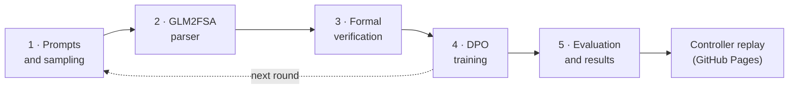

# LogicTune documentation

This folder documents the pipeline one stage at a time. Each page starts with links to the code it describes, and the [root README](../README.md) gives the overview.

| Layer | Page | Covers | Code |
|---|---|---|---|
| Pipeline | [01 · Prompts and sampling](01-prompts-and-sampling.md) | System prompt, 17 scenarios, train / held-out split, seeded decoding | `prompts.py`, `generation.py` |
| Pipeline | [02 · GLM2FSA parser](02-glm2fsa-parser.md) | Text → prioritized guarded rules, if/else chains, free atoms, the reward-hacking fix | `glm2fsa.py` |
| Pipeline | [03 · Formal verification](03-formal-verification.md) | Environment, fairness, 15 LTL specs, generated SMV, nuXmv vs explicit checker | `verifier.py`, `specs.py`, `environment.py` |
| Pipeline | [04 · DPO training](04-dpo-training.md) | Preference pairs, LoRA DPO, merged on-policy rounds | `data_generator.py`, `trainer.py`, `pipeline.py` |
| Pipeline | [05 · Evaluation and results](05-evaluation-and-results.md) | Protocol, statistics, measured results, limitations | `evaluator.py`, `stats.py`, `results/latest/` |
| Code | [`src/logictune/`](../src/logictune/README.md) | Module map and Python API | all modules |
| Operations | [`slurm/`](../slurm/README.md) | Running the pipeline on a Slurm cluster (Unity HPC) | `slurm/*.sbatch` |
| Operations | [`results/`](../results/README.md) | Files, schemas, re-verification | `export.py`, `scripts/` |
| Operations | [`simulator/`](../simulator/README.md) | Controller replay site and its deployment | `simulator/`, `.github/workflows/pages.yml` |
