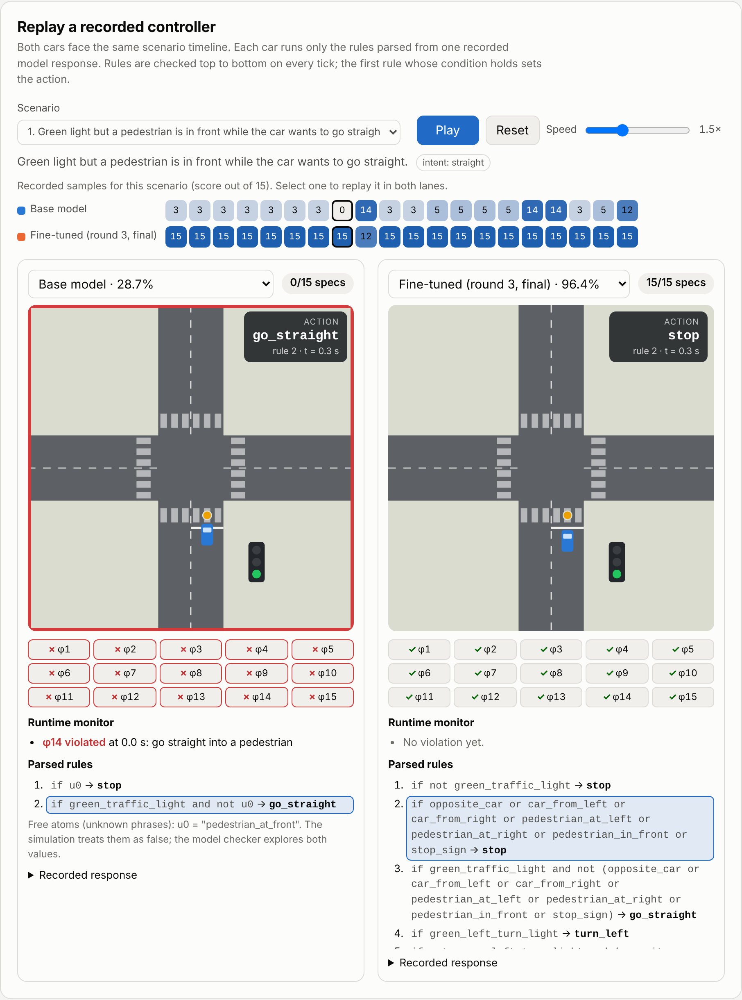
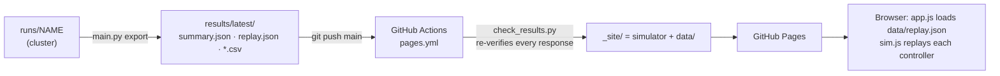

# Controller replay (GitHub Pages)

A static page replays the recorded controllers from the latest committed results. Nothing is generated in the browser: every response, parsed rule, score, and verdict shown comes from `results/latest`. The live page is <https://alirafiqmalik.github.io/LogicTune/>.





## What each lane shows

| Element | Source | Meaning |
|---|---|---|
| Score pill and 15 chips | `replay.json → samples[model][i].specs` | Model-checking verdicts (nuXmv, from the run) |
| Parsed rules | `samples[model][i].rules` | The controller; the rule that fires on the current tick is highlighted |
| Car and HUD | `sim.js` | First matching rule on the current propositions; **NO RULE** means the action is undefined |
| Runtime monitor | `sim.js → MONITORS` | State-action invariants (φ2, φ3, φ5, φ6, φ9, φ11, φ12, φ14, φ15) checked on every tick |
| Sample strip | all samples of the scenario | Score of each recorded sample; click to replay it in both lanes |
| Results charts | `replay.json → rounds` | Satisfaction, full-pass rate, per-spec and per-scenario changes |

Each scenario starts from its initial propositions (`prompts.SCENARIOS[i].init`) and changes them at fixed times: pedestrians clear after 4 s, cross traffic after 4-5 s, and red lights turn green after 5 s. Scenarios without a traffic light (10, 11, 12, 16) start with `green_traffic_light` false and set it true at 6 s. Every timeline thus ends in the state the model checker's fairness assumption requires: the light is green and the intersection is clear. Other cars and pedestrians drive or walk out of the ego car's path and are clear of it at the moment their proposition turns false; they then continue until they leave the canvas. Both lanes see the same timeline, and a stop sign counts as obeyed after the car has waited 0.75 s at the line. Free atoms are false in the simulation, while the model checker explores both values. The simulation is an illustration, and the score comes from the model checker.

## Run it locally

```bash
python -m http.server 8000      # from the repository root
# open http://localhost:8000/simulator/   (it reads ../results/latest/index.json)
```

## Tests

The simulator logic has a dependency-free test suite that runs with Node's built-in runner (Node 22 or newer):

```bash
node --test "simulator/tests/*.test.js"
```

## Files

| File | Role |
|---|---|
| [`index.html`](index.html) | Page layout and lane template |
| [`assets/sim.js`](assets/sim.js) | Scenario timelines, rule evaluation, car and other road-user motion, runtime monitor, episode outcome, canvas drawing |
| [`assets/replaystate.js`](assets/replaystate.js) | Pure helpers for `app.js`: sample lookup, URL state parsing and validation (`#r=…&s=…&i=…&a=…&b=…`), data folder choice |
| [`assets/app.js`](assets/app.js) | Loads `index.json` and `replay.json`, wires lanes, strip, URL state and hash navigation |
| [`assets/charts.js`](assets/charts.js) | Dependency-free SVG charts with tooltips |
| [`assets/style.css`](assets/style.css) | Light and dark themes |
| [`tests/`](tests) | `node --test` suite for `sim.js` and `replaystate.js` (no dependencies) |

- [`.github/workflows/pages.yml`](../.github/workflows/pages.yml) runs on every push to `main` that touches the simulator, the results, or the package.
- It first runs [`scripts/check_results.py`](../scripts/check_results.py), which re-parses and re-verifies every recorded response and fails the deploy if any score differs from the recorded one.
- It copies `simulator/` and `results/latest/` into the site and publishes it with `actions/deploy-pages`.
