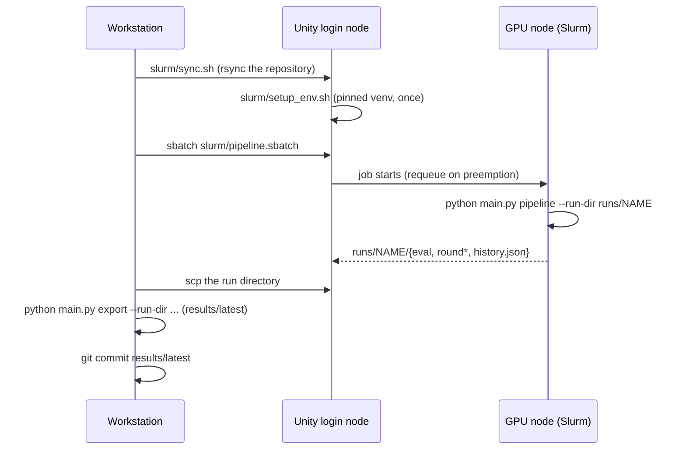

# Running on a Slurm cluster (Unity HPC)

The GPU stages (sampling, DPO, and evaluation) run as one resumable Slurm job per experiment. All cluster paths come from environment variables, so nothing in the repository names a specific account. The results in `results/latest` were produced this way on the UMass Unity cluster.



## Files

| File | Purpose |
|---|---|
| [`env.sh`](env.sh) | Shared variables: `LOGICTUNE_WORK` (venv, HF cache, runs, logs), `LOGICTUNE_SRC`, `LOGICTUNE_VENV`, `HF_HOME` |
| [`setup_env.sh`](setup_env.sh) | One-time pinned environment: PyTorch 2.5.1 (cu124), transformers 4.46.3, TRL 0.12.2, PEFT 0.13.2 |
| [`pipeline.sbatch`](pipeline.sbatch) | Base evaluation → 3 DPO rounds → evaluation; `--requeue`, resumes finished stages |
| [`probe.sbatch`](probe.sbatch) | Evaluate one model only (quick baseline check) |
| [`sync.sh`](sync.sh) | rsync the repository to the cluster and record the source commit |

## Commands

```bash
# 1. once: copy the code and build the environment
export UNITY_HOST=unity                                  # ssh alias
export LOGICTUNE_WORK=/work/<group>/<user>/logictune     # remote work dir
slurm/sync.sh
ssh $UNITY_HOST "cd $LOGICTUNE_WORK/src && LOGICTUNE_WORK=$LOGICTUNE_WORK bash slurm/setup_env.sh"

# 2. a baseline probe (4 samples per evaluation prompt)
ssh $UNITY_HOST "cd $LOGICTUNE_WORK/src && LOGICTUNE_WORK=$LOGICTUNE_WORK RUN_NAME=probe MODEL=Qwen/Qwen2.5-3B-Instruct \
    sbatch --export=ALL -p gpu-preempt --gpus=1 slurm/probe.sbatch"

# 3. the full experiment
ssh $UNITY_HOST "cd $LOGICTUNE_WORK/src && LOGICTUNE_WORK=$LOGICTUNE_WORK RUN_NAME=qwen3b \
    sbatch --export=ALL -p gpu-preempt,gpu-preempt-highvram --constraint='a100|l40s|h100' \
    slurm/pipeline.sbatch --base-model Qwen/Qwen2.5-3B-Instruct --batch-size 4 --grad-accum 4"

# 4. bring the run home and publish it
rsync -a --exclude 'round*/model' --exclude 'round*/trainer' $UNITY_HOST:$LOGICTUNE_WORK/runs/qwen3b runs/
python main.py export --run-dir runs/qwen3b --run-id qwen2.5-3b
python scripts/check_results.py && python scripts/plot_results.py
```

- Every stage writes its outputs under `runs/NAME` and is skipped when they exist, so a preempted job that Slurm requeues continues where it stopped.
- The job writes the GPU name and the source commit into the run directory, and `export` copies them into `summary.json`.
- Merged model weights stay on the cluster. They are not part of `results/latest`.
- Any pipeline flag from `PipelineConfig` can be passed after the script name (for example `--rounds`, `--learning-rate`, `--rpo-alpha`).

The optional unity-hpc-controller (a separate project) can also submit these jobs, but plain `sbatch` was used here because each iteration of debugging needed a fresh job.
