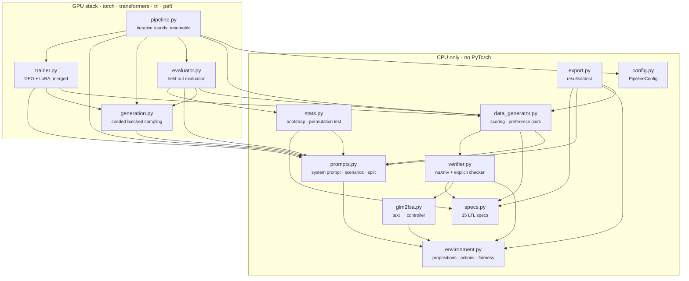

# `logictune` package

The `logictune` package contains the pipeline from prompts and parsing through verification, preference pairs, DPO, evaluation, and export. The light modules import without PyTorch, so verification, tests, exports, and CI run on a laptop, while generation and training need the GPU stack.



| Module | Main entry points | Stage doc |
|---|---|---|
| [`prompts.py`](prompts.py) | `SYSTEM_PROMPT`, `SCENARIOS`, `train_prompts()`, `eval_prompts()`, `chat_prompt()` | [01 · Prompts and sampling](../../docs/01-prompts-and-sampling.md) |
| [`generation.py`](generation.py) | `load_model()`, `sample_responses()` | [01 · Prompts and sampling](../../docs/01-prompts-and-sampling.md) |
| [`glm2fsa.py`](glm2fsa.py) | `extract_rules()`, `parse_condition()`, `parse_action()`, `Controller` | [02 · GLM2FSA parser](../../docs/02-glm2fsa-parser.md) |
| [`environment.py`](environment.py), [`specs.py`](specs.py) | `PROPOSITIONS`, `ACTIONS`, `fairness_smv()`, `SPECS` | [03 · Formal verification](../../docs/03-formal-verification.md) |
| [`verifier.py`](verifier.py) | `verify_response()`, `verify_controller()`, `controller_to_smv()`, `run_nuxmv()` | [03 · Formal verification](../../docs/03-formal-verification.md) |
| [`data_generator.py`](data_generator.py) | `score_samples()`, `build_preference_pairs()` | [04 · DPO training](../../docs/04-dpo-training.md) |
| [`trainer.py`](trainer.py) | `train_dpo()` | [04 · DPO training](../../docs/04-dpo-training.md) |
| [`evaluator.py`](evaluator.py), [`stats.py`](stats.py) | `evaluate_model()`, `compare()`, `summarize_eval()` | [05 · Evaluation and results](../../docs/05-evaluation-and-results.md) |
| [`pipeline.py`](pipeline.py), [`config.py`](config.py) | `run_pipeline()`, `PipelineConfig` | [04 · DPO training](../../docs/04-dpo-training.md) |
| [`export.py`](export.py) | `export_run()`, `update_index()` | [results/README.md](../../results/README.md) |

## Minimal use

```python
import sys; sys.path.insert(0, "src")
from logictune import verify_response, format_result, SYSTEM_PROMPT

print(SYSTEM_PROMPT)
res = verify_response("1. If pedestrian_in_front, stop.\n2. If not green_traffic_light, stop.\n3. Otherwise, go_straight.")
print(format_result(res))   # parsed rules, score, 15 verdicts
```

```python
# GPU: the full pipeline (what slurm/pipeline.sbatch runs)
from logictune.config import PipelineConfig
from logictune.pipeline import run_pipeline

run_pipeline(PipelineConfig(base_model="Qwen/Qwen2.5-3B-Instruct", rounds=3), "runs/qwen3b")
```

The command-line interface in `main.py` wraps these calls (`demo`, `verify`, `pipeline`, `evaluate`, `export`).
